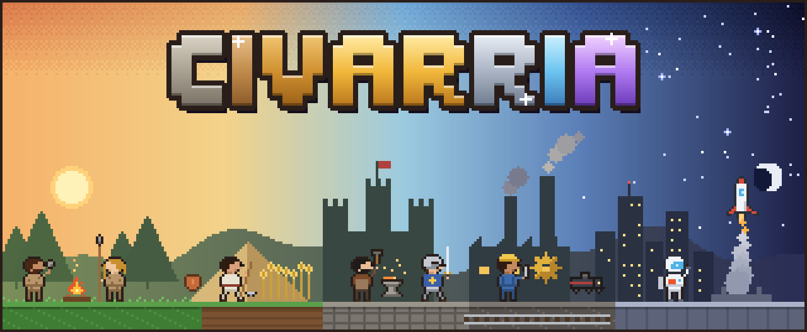

# Civarria

Zivilisationen beobachten wie in einem Terrarium: Hunderte Menschen mit eigenen Persönlichkeiten überleben, entdecken, streiten und verbünden sich – von der Steinzeit an.

## Installieren
Unter **Releases** die Datei `Civarria-Setup-x.y.z.exe` herunterladen und ausführen. Das Setup legt eine Desktop-Verknüpfung an. Neue Versionen lädt das Programm danach selbst herunter.

Spielstände liegen unter `Dokumente\Civarria\Spielstände`.

## Für Entwickler
- `src/` – Quelltext (core.js = Simulation, culture.js = Werte, Gebote & Herrschaftsformen, techtree.js = Zivilisationsbaum, town.js = Siedlungen im Raster, worker.js = Simulations-Thread, ui.js = Darstellung, sprites.js = Pixel-Figuren)
- `npm run build` – setzt `app/index.html` zusammen
- `npm start` – startet das Programm
- Release: Version in `package.json` erhöhen und auf `main` pushen → GitHub Actions baut das Setup und veröffentlicht es
